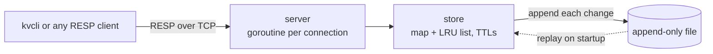

# kvstore

An in-memory key-value database written from scratch in Go, inspired by Redis. It runs as a TCP server that speaks RESP (the Redis wire protocol), evicts least recently used keys when full, expires keys after a TTL, and persists every change to an append-only file so data survives restarts and crashes.

- **TCP server**, one goroutine per client, sharing a single thread-safe store
- **RESP protocol**, binary-safe, with input limits so a single client can't exhaust memory
- **TTL expiration** with `SET key value EX seconds`
- **O(1) LRU eviction** with a hash map plus a doubly linked list
- **Append-only file persistence** with write-ahead logging and crash recovery
- **Graceful shutdown** that syncs data to disk on Ctrl+C
- **`kvcli`**, an interactive command-line client
- **100+ tests**, including concurrency tests run under Go's race detector

## Quick start

Requires Go 1.26 or newer.

```bash
git clone https://github.com/ervinjohn50/kvstore.git
cd kvstore
go run . -aof data.aof
```

In another terminal:

```bash
go run ./cmd/kvcli
```

```
127.0.0.1:6380> SET name alice
OK
127.0.0.1:6380> GET name
"alice"
127.0.0.1:6380> SET session abc123 EX 60
OK
127.0.0.1:6380> DEL name nope
(integer) 1
127.0.0.1:6380> GET name
(nil)
```

Stop the server with Ctrl+C and start it again with the same `-aof` file, and your data is still there.

## Usage

### Server

```bash
go run . [flags]
```

| Flag | Default | Description |
|---|---|---|
| `-addr` | `127.0.0.1:6380` | Address to listen on. Local-only by default, since there's no authentication. |
| `-maxkeys` | `0` | Evict least recently used keys beyond this many. `0` means no limit. |
| `-aof` | *(empty)* | Append-only file to persist data in. Empty means memory only. |

### Client

```bash
go run ./cmd/kvcli                    # interactive prompt
go run ./cmd/kvcli SET name alice     # run one command and exit
go run ./cmd/kvcli -addr host:port    # connect to another server
```

The prompt accepts quoted arguments (`SET greeting "hello world"`). Leave with `quit`, `exit`, or Ctrl+D.

### Commands

Command names are case-insensitive.

| Command | Reply |
|---|---|
| `PING [message]` | `PONG`, or the message |
| `SET key value [EX seconds]` | `OK` |
| `GET key` | The value, or `(nil)` if missing or expired |
| `DEL key [key ...]` | How many of the keys existed |

## Architecture



| Package | Responsibility |
|---|---|
| [`main.go`](main.go) | Flags, startup, graceful shutdown |
| [`server/`](server) | Accepts connections and runs each command against the store |
| [`resp/`](resp) | Reads and writes RESP commands and replies |
| [`store/`](store) | The data: hash map, LRU list, TTLs, and the append-only file |
| [`client/`](client) | A small Go client library |
| [`cmd/kvcli/`](cmd/kvcli) | The command-line client |

## Design decisions

### Concurrency

Each client connection gets its own goroutine, so a slow client never blocks the others. All goroutines share one store guarded by a single `sync.Mutex`. A read-write lock wouldn't help here: every `GET` updates the LRU order (and may delete an expired key), so reads modify the store too.

### LRU eviction in O(1)

The store keeps a hash map from each key to its node in a doubly linked list, ordered from most to least recently used. A lookup goes straight to the node through the map, moving a node to the front is a pointer update, and eviction removes the node at the back, so `GET`, `SET`, and eviction all take constant time. Both reads and writes count as a use.

### Lazy expiration

An expired key is removed when it's next accessed, rather than by a background timer. This keeps the design simple and costs nothing when keys aren't being read. The tradeoff is that expired keys nobody reads stay in memory until they're evicted or deleted. Redis combines this with periodic background sampling.

### RESP parsing

Values are read by their declared length instead of by scanning for line endings, so they can contain any bytes, including `\r\n`. Because the server reads input from the network, the parser caps array length (1,024 arguments), value size (1 MiB), and header line length (4 KiB). Without those caps, a request like `$999999999` could make the server allocate a gigabyte. A malformed request gets an error reply and the connection is closed, since there's no reliable way to find where the next command starts.

### Persistence

Every change is appended to the file as a RESP command, the same format clients send. Without the RESP framing, a file looks like this:

```
SET name alice
SET session abc123 PXAT 1791878844146
DEL name
```

On startup, the store replays the file from the top to rebuild its data.

- **Write-ahead logging.** A change is written to the file before it's applied in memory. If the write fails, memory is left unchanged and the client gets an error instead of `OK`. After the first failure, the store refuses all writes but keeps serving reads, because the file may now end in a partial command.
- **Ordered under the lock.** Changes are logged while the store's lock is held, so the file records them in exactly the order they were applied, even with many clients writing at once.
- **Absolute expiry times.** A TTL is stored as the time the key expires (`PXAT`, in Unix milliseconds), not the time remaining, so restarting doesn't give keys a fresh TTL. A key that expired while the server was down is deleted during replay rather than skipped, so an older value of it earlier in the file can't come back.
- **Evictions are logged.** Reads aren't logged, so replaying with the LRU limit could evict different keys than the original run did. Logging each eviction as a `DEL`, and replaying with no limit, restores exactly the keys that were present.
- **Crash recovery.** A crash mid-write can leave a partial command at the end of the file. Startup cuts it off with a warning, so new commands aren't appended after garbage. Corruption anywhere else stops the server from starting, rather than silently dropping data.
- **Durability.** Each change reaches the operating system before the client gets a reply, so it survives the server process crashing. The file is synced to disk once per second (like Redis's `appendfsync everysec`), so a power loss can lose about the last second of writes.

## Testing

```bash
go test -race ./...
```

The tests cover the protocol parser (including malformed and truncated input), every command and error reply over a real TCP connection, LRU ordering, TTL expiry, the client prompt, and persistence: restoring data, absolute expiry, evictions surviving restarts, repairing a truncated file, rejecting a corrupt one, and refusing writes after a disk failure. Concurrency tests run many clients against one server under the race detector.

## Limitations and future work

- **AOF compaction.** The file grows with every change, even for keys that were later overwritten. Redis periodically rewrites it to one command per live key (`BGREWRITEAOF`).
- **Memory-based limits.** Eviction is based on the number of keys. Redis limits memory (`maxmemory`) and approximates LRU by sampling.
- **Active expiration.** A background sweep would reclaim memory from expired keys that are never read.
- **Lock contention.** One lock serializes all commands. Splitting the store into independently locked shards would let commands on different keys run in parallel.
- **Authentication and more commands.** There's no password support, and only `PING`, `GET`, `SET`, and `DEL` are implemented.
